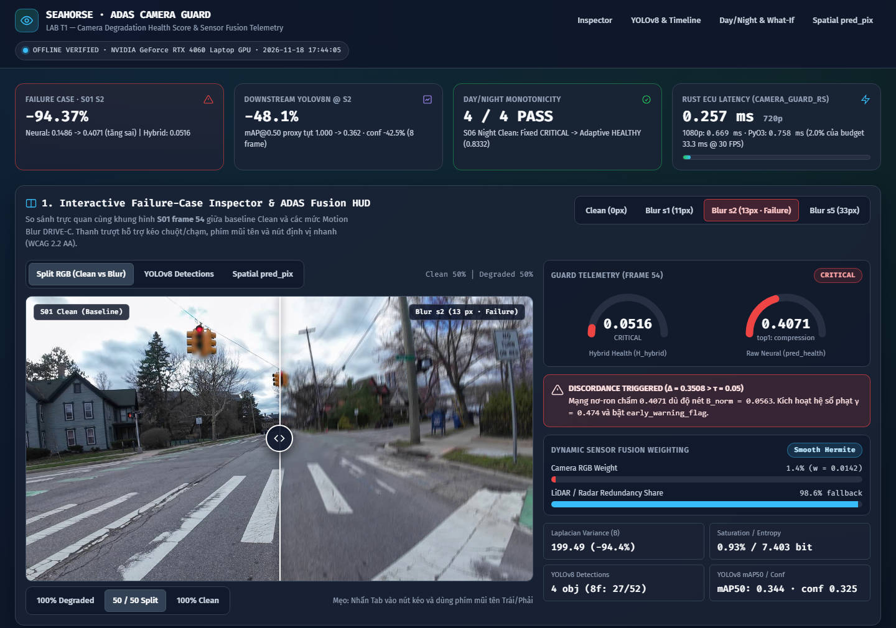
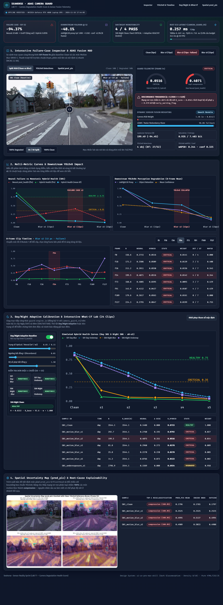

# Seahorse · Sensor Reality Sprint

LAB **T1 — Camera degradation health score**, ADAS vehicle platform. The team investigated how motion blur affects image metrics and the health score of PerceptionHealthNet on the same scene.

**Results:** A demo of **4 S01 clips**, comprising clean and motion blur s1/s2/s5, was run on CPU. At s2, the blur score dropped by **94.37%**, yet health increased both at frame 54 and across the 8-frame average. This represents a quality ranking failure case on the tested sample; downstream detector/mAP or ADAS safety was not measured.

## Interactive Visualization UI (ADAS Telemetry Cockpit)

A zero-build **HTML5 + CSS3 + Vanilla JS** telemetry dashboard (`web/`) built with the [ui-ux-pro-max design system](design-system/seahorse-adas-guard/MASTER.md) visualizes the failure case, downstream YOLOv8 impact, 24-clip Day/Night adaptive What-If simulator (exact JS port of [`camera_guard_rs`](crates/camera_guard_rs/README.md)), and `pred_pix` spatial uncertainty maps.



<details>
<summary>View full-page 4-module dashboard screenshot (Inspector · YOLOv8 &amp; Timeline · Day/Night What-If Lab · Spatial pred_pix)</summary>



</details>

Launch locally from the repository root:

```powershell
python scripts/serve_ui.py --open
```

## Running the small demo on CPU

Requires Git, Python, and Internet access. Tested environment: Python 3.13.15; library versions documented in [manifest](outputs/stage3_small/run_manifest.json) and [requirements-demo.txt](requirements-demo.txt). Run from the repository root:

```powershell
python -m venv .venv
.venv\Scripts\python.exe -m pip install torch==2.14.1 torchvision==0.29.1 --index-url https://download.pytorch.org/whl/cpu
.venv\Scripts\python.exe -m pip install -r requirements-demo.txt
.venv\Scripts\python.exe scripts/setup_demo.py
.venv\Scripts\python.exe scripts/stage3_small_demo.py --threads 4 --output outputs/stage3_repeat
.venv\Scripts\python.exe scripts/verify_submission.py
```

Linux/macOS uses `.venv/bin/python`. If dependencies are already installed, use `python` directly. No GPU/Colab/Kaggle required.

Setup creates an isolated clone at `.lab_cache/drive-c-source`, locks the commit, and verifies the checkpoint SHA-256. If the checkpoint is missing, it downloads approximately **94 MB** separately from the locked source. The benchmark only downloads **4 clips**, totaling approximately **54 MB**, when cache is missing; it does not download the entire dataset. The cache is excluded from Git.

`--output outputs/stage3_repeat` preserves the saved reference evidence. Omitting `--output` will update `outputs/stage3_small/`. Any incorrect source commit, mismatched checkpoint/video hash, or clip mean-8 discrepancy $\ge 0.001$ with the author metadata will cause the script to raise an error. The [small configuration](configs/benchmark_small.json) inherits model and metric parameters from the [base configuration](configs/benchmark.json).

## Problem and Method

The sensor is an RGB camera; failure mode is motion blur; the relevant feature is input quality monitoring prior to object detection. Baseline is clean video of the same scene/frame, with no synthetic corruption applied. Original claim: as blur increases $\to$ variance of Laplacian and predicted health are expected to decrease. Samples were purposefully selected after inspecting historical results to reproduce the anomaly, not via random sampling.

Two papers by Shiva Aher serve distinct roles:

- *Safety-Critical Camera Reliability Monitoring for ADAS via Degradation-Aware Uncertainty Pattern Analysis*, arXiv:2605.05439v1: GSHI methodology, model architecture, and limitations. [PDF](<paper/Safety-Critical Camera Reliability Monitoring for ADAS via Degradation-Aware Uncertainty Pattern Analysis.pdf>).
- *DRIVE-C: A Controlled Corruption Dataset for Autonomous Driving*, arXiv:2605.09774v1: Controlled baseline dataset and baseline checkpoint. [PDF](<paper/DRIVE-C A Controlled Corruption Dataset for Autonomous Driving.pdf>).

Execution source: [drive-c-dataset v1.0.1](https://github.com/shiv-aher/drive-c-dataset/tree/v1.0.1), commit `caf16657b87cec8518008b74c72dd0dcb6088eb6`. Data: [Zenodo 19656444](https://doi.org/10.5281/zenodo.19656444). Checkpoint `epoch_021_best.pth`, SHA-256 `c210d9a4f207584687583d1ab5b96a99e12b2f3dbb2727464c6c039e44fb8c0b`.

The multi-head EfficientNet-B2 model directly outputs `pred_health`; the team did not retrain it. Input RGB is resized to 384 × 1280, divided by 255, in CHW layout, evaluated with no gradient. `gshi_gt` is computed from severity, not from detector/safety ground truth. [PAPER_CODE_MAPPING.md](reports/PAPER_CODE_MAPPING.md) documents discrepancies in formula, taxonomy, and loss between paper and source code; does not claim reproduction of all paper experiments.

## Benchmark and Evidence

**[TEAM MEASURED]** S01 clean + blur s1/s2/s5, kernel 11/13/33 px. Each clip samples frames 0/18/36/54/73/91/109/127, totaling **32 health outputs**. Handcrafted metrics measured at native 1280 × 720 frame 54:

| Metric | Computation | Unit |
| --- | --- | --- |
| B | Variance of Laplacian on uint8 grayscale, CV_64F, ksize=1, ddof=0 | Response variance on 0–255 pixel scale; proxy for sharpness |
| S_pct | 100 × fraction of gray ≤5 or ≥250 | % of extreme dark/bright pixels |
| H_bit | −Σ p log₂(p), 256-bin grayscale histogram | bit |
| Health | Direct health head; frame 54 and mean-8 reported separately | Unitless, 0–1 |

| Condition | B | S_pct (%) | H_bit (bit) | Health f54 | Health mean8 |
| --- | ---: | ---: | ---: | ---: | ---: |
| Clean | 3544.1384 | 1.6558 | 7.5152 | 0.148770 | 0.221979 |
| Blur s1, 11 px | 292.6951 | 1.0954 | 7.4132 | 0.275987 | 0.318326 |
| Blur s2, 13 px | 199.4923 | 0.9299 | 7.4035 | 0.407456 | 0.356979 |
| Blur s5, 33 px | 14.2645 | 0.4564 | 7.3848 | 0.076573 | 0.059943 |

Total forward inference time **7.20 seconds** on 4 CPU threads; entire cached script executed in **13.33 seconds**, excluding initial download. Maximum mean-8 discrepancy with author metadata is **0.000322928 < 0.001**. Exact numerical match confirms pipeline reproduction, not that the health score itself is correct.


Evidence: [Summary CSV](outputs/stage3_small/benchmark_summary.csv), [32 frame health rows](outputs/stage3_small/per_frame.csv), [Monotonicity check](outputs/stage3_small/monotonicity.csv), [Execution log](outputs/stage3_small/run.log), [Run manifest](outputs/stage3_small/run_manifest.json), [Corruption parameters](outputs/stage3_small/corruption_parameters.json), [STAGE3_REPORT.md](docs/STAGE3_REPORT.md).

## Failure case and Engineering decision

At s2, B dropped by **94.37%**, yet health f54 increased by **0.258686** and mean-8 increased by **0.135000** relative to clean. A quality ranking based solely on health would prioritize s2 over clean in this instance. **[HYPOTHESIS]** Domain/scene shifts or uncalibrated health heads may contribute; root cause remains unverified.

**Proposal:** Log health alongside B/S/H metrics; inspect discordant samples before calibrating camera down-weighting thresholds. Add diverse scenes and separate calibration/test sets to measure false-positive and false-negative warnings. A better combined rule has not yet been deployed or proven. See [ENGINEERING_DECISION.md](reports/ENGINEERING_DECISION.md).

Limitations: Single scene, single synthetic corruption type; frames within the same clip are not independent; levels s3/s4, night scenes, or underexposure were not evaluated in the small demo. Multiple PSF parameters vary simultaneously with severity, preventing isolation of kernel size alone. Metric B depends on texture/exposure; S/H have no universal good/bad direction. Downstream detector/mAP, end-to-end latency, sensor fusion, and early warning lead were not measured. Paper numbers are **[SOURCE]** citations, not the team's measured results.

## Reports and Presentation

| Member | Role | Individual Report |
| --- | --- | --- |
| Lưu Quang Khải — 2A202602599 | Team Lead, benchmark design & decision | [Khải](reports/2A202602599_LuuQuangKhai.md) |
| Lê Tuấn Hưng — 2A202602665 | Documentation & paper–code mapping | [Hưng](reports/2A202602665_LeTuanHung.md) |
| Đặng ĐỈnh Đoàn — 2A202602927 | Code & benchmark execution | [Đoàn](reports/2A202602927_DangDinhDoan.md) |
| Nguyễn Hồ Nam — 2A202602788 | Results, visualization & pitch | [Nam](reports/2A202602788_NguyenHoNam.md) |

[TEAMMATES.md](TEAMMATES.md) · [PITCH.md](reports/PITCH.md) (script drafted for 4 min 15 sec, not timed live) · [Submission Checklist](reports/SUBMISSION_CHECKLIST.md) · [Completion Plan](reports/LAB_COMPLETION_PLAN.md).

Each member audits their individual report, documents actual contributions, and submits independently on VLearn along with the repository URL. Local files must be pushed to GitHub before final submission.

## Historical Results

[test-drivec.ipynb](test-drivec.ipynb), [phn_24_results.csv](outputs/phn_24_results.csv), [phn_per_frame.csv](outputs/phn_per_frame.csv), [phn_curve.png](outputs/phn_curve.png), [fetch_sha256.txt](fetch_sha256.txt) represent artifacts from the historical 24-clip exploration. [BENCHMARK_HISTORY.md](docs/BENCHMARK_HISTORY.md) retains the legacy description. **Rerunning the 24 clips is not required**; the four-clip suite serves as the primary verified evidence.

The `drive-c-dataset/` source is referenced via submodule at the pinned commit; setup uses an isolated clone in cache. Attribution and DRIVE-C terms of use must be maintained when sharing code, checkpoints, and data.
